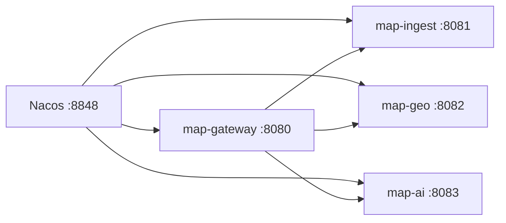

# Nacos 安装与使用（ai-open-map）

本文说明在本项目中安装、启动 Nacos，并通过 **Spring Cloud 服务发现** 让网关与三个业务服务协同工作。与 [03-运行与接口](03-运行与接口.md) 第 4 节、[01-架构与技术栈](01-架构与技术栈.md) 中的说明一致，并补充 Windows 本地实操步骤。

## 1. 在本项目里 Nacos 做什么

| 组件 | 默认模式（`application.yml`） | Cloud 模式（`application-cloud.yml`） |
| --- | --- | --- |
| map-gateway | 路由写死 `http://127.0.0.1:8081/8082/8083`；Nacos 客户端配置在，**不注册、不发现** | 启用发现与注册；路由改为 `lb://map-ingest` 等 |
| map-ingest / map-geo / map-ai | 同上，发现关闭 | 注册到 Nacos，服务名即 `spring.application.name` |

版本对应关系（见根目录 `pom.xml`）：

- Spring Boot **3.2.12**
- Spring Cloud **2023.0.3**
- Spring Cloud Alibaba **2023.0.3.4**
- 推荐 Nacos Server **2.3.x**（仓库脚本默认下载 **2.3.2**）

环境变量：

| 变量 | 默认值 | 说明 |
| --- | --- | --- |
| `NACOS_ADDR` | `127.0.0.1:8848` | 各服务 `spring.cloud.nacos.discovery.server-addr` |

## 2. 安装 Nacos（Windows，推荐）

### 2.1 前置条件

- **JDK 17+**（与后端一致；Nacos 2.3 同样依赖 Java）
- 本机 **8848** 端口未被占用
- 能访问 GitHub  release（首次需下载约 150MB 压缩包）

### 2.2 一键下载（仓库脚本）

在仓库根目录 PowerShell 中执行：

```powershell
.\scripts\install-nacos.ps1
```

脚本会把 Nacos 解压到 `tools/nacos-server/nacos/`（该目录已加入 `.gitignore`，不会进 Git）。

若 GitHub 较慢，可手动下载 [nacos-server-2.3.2.zip](https://github.com/alibaba/nacos/releases/download/2.3.2/nacos-server-2.3.2.zip)，解压后保证路径为：

`tools/nacos-server/nacos/bin/startup.cmd`

### 2.3 启动与停止

```powershell
.\scripts\start-nacos.ps1
.\scripts\stop-nacos.ps1
```

或手动：

```powershell
cd tools\nacos-server\nacos\bin
cmd /c "startup.cmd -m standalone"
# 停止
cmd /c shutdown.cmd
```

**单机模式**（`-m standalone`）使用内嵌 Derby，适合本地开发，无需 MySQL。

### 2.4 控制台与鉴权

- 地址：**http://127.0.0.1:8848/nacos**
- 官方默认账号：`nacos` / `nacos`
- 解压包中 `conf/application.properties` 里 **`nacos.core.auth.enabled=false`**（鉴权关闭），本地 Spring 客户端**不必**配置 username/password。
- 若你在生产环境打开鉴权，需在 Spring 中增加：

```yaml
spring:
  cloud:
    nacos:
      discovery:
        username: nacos
        password: nacos
```

### 2.5 可选：Docker

本机已安装 Docker 时可用（与脚本安装二选一）：

```powershell
docker run -d --name nacos -p 8848:8848 -e MODE=standalone nacos/nacos-server:v2.3.2
```

同样设置 `NACOS_ADDR=127.0.0.1:8848` 即可。

## 3. 与本项目联调（Cloud 模式）

### 3.1 启动顺序



1. 启动 Nacos（见上节）。
2. 在**仓库根目录**（含 `pom.xml` 的 `ai-open-map`）编译（若尚未打包）：

```powershell
cd D:\git_files\soft-tools\ai-open-map   # 按你的实际路径
mvn -DskipTests package
```

3. 四个 Java 进程均激活 **`cloud`** profile：

**方式 A — 脚本（会先起 Nacos）：**

```powershell
# 仍在仓库根目录执行；不要写成「mvn ... package .\scripts\...」一行，Maven 会把 .ps1 当成 goal
.\scripts\start-all-cloud.ps1
```

一条 PowerShell 里连续执行时用分号：

```powershell
cd D:\git_files\soft-tools\ai-open-map; mvn -DskipTests package; .\scripts\start-all-cloud.ps1
```

**方式 B — 手动：**

```powershell
$env:NACOS_ADDR = "127.0.0.1:8848"
java -jar backend\map-ingest\target\map-ingest-0.1.0.jar --spring.profiles.active=cloud
java -jar backend\map-geo\target\map-geo-0.1.0.jar --spring.profiles.active=cloud
java -jar backend\map-ai\target\map-ai-0.1.0.jar --spring.profiles.active=cloud
java -jar backend\map-gateway\target\map-gateway-0.1.0.jar --spring.profiles.active=cloud
```

默认的 `.\scripts\start-all.ps1` **不会**连 Nacos，仍走固定 IP 路由。

### 3.2 在 Nacos 上验证注册

打开控制台 → **服务管理 → 服务列表**，命名空间选 **public**，应看到：

| 服务名 | 端口 | 说明 |
| --- | --- | --- |
| map-ingest | 8081 | 入库 |
| map-geo | 8082 | 地图与瓦片 |
| map-ai | 8083 | 对话 |
| map-gateway | 8080 | 网关（也会注册，便于其他系统发现） |

也可调用 Open API（鉴权关闭时）：

```powershell
Invoke-RestMethod "http://127.0.0.1:8848/nacos/v1/ns/service/list?pageNo=1&pageSize=10"
```

### 3.3 网关路由变化

`application-cloud.yml` 将 Gateway 路由从固定地址改为负载均衡服务名：

```yaml
spring:
  cloud:
    gateway:
      routes:
        - id: ingest
          uri: lb://map-ingest
        - id: geo
          uri: lb://map-geo
        - id: ai
          uri: lb://map-ai
```

前端仍通过 **http://127.0.0.1:8080** 访问，路径不变（`/api/ingest/**`、`/api/geo/**` 等）。

### 3.4 已知限制（0.1）

- **map-ai → map-geo** 仍使用配置项 `app.geo.base-url`（默认 `http://127.0.0.1:8082`），cloud 模式**未**自动改为 `lb://map-geo`。若 geo 只通过 Nacos 暴露、端口变化，需自行改配置或经网关转发。
- 单机 Nacos + 单实例每个服务时，`lb://` 与直连 808x 行为等价。

## 4. 配置说明（代码位置）

**网关默认**（发现关闭、固定 URI）见 `backend/map-gateway/src/main/resources/application.yml`：

- `spring.cloud.nacos.discovery.enabled: true` 仅表示客户端可连 Nacos（并配合 `fail-fast: false` 在 Nacos 未起时不拖垮启动）
- `spring.cloud.discovery.enabled: false` 与 `service-registry.auto-registration.enabled: false` 关闭注册

**Cloud 覆盖**见各模块 `application-cloud.yml`，例如 `backend/map-gateway/src/main/resources/application-cloud.yml`。

依赖：`spring-cloud-starter-alibaba-nacos-discovery`（各 backend 模块 `pom.xml`）。

## 5. 常见问题

| 现象 | 处理 |
| --- | --- |
| 8848 被占用 | `Get-NetTCPConnection -LocalPort 8848` 查进程；改 Nacos `server.port` 或换机器，并设置 `NACOS_ADDR` |
| 服务启动报 Nacos 连接失败 | 先 `start-nacos.ps1`；或保持默认 profile（不启 cloud），网关仍可直连 808x |
| 控制台无服务 | 确认四个进程都带 `--spring.profiles.active=cloud`；看 `logs/map-*.log` |
| GitHub 下载失败 | 浏览器/镜像下载 zip 后手动解压到 `tools/nacos-server/` |
| 启动脚本中文乱码报错 | 用 `start-nacos.ps1` 同目录下手动 `startup.cmd -m standalone`，或确保 ps1 为 UTF-8 with BOM |
| `mvn ... no POM in ...\scripts` | 先 `cd` 到仓库根目录再跑 `mvn`；`mvn` 与 `.\scripts\start-all-cloud.ps1` 是两条命令 |
| `InvalidVariableReferenceWithDrive` / `127.0.0.1:$port` | 已用 `${port}` 修复；拉最新 `scripts/start-all-cloud.ps1` |

日志位置：

- Nacos：`tools/nacos-server/nacos/logs/`
- 业务：`logs/map-*.log`（与 `start-all.ps1` 相同）

## 6. 回到「无 Nacos」开发

1. `.\scripts\stop-nacos.ps1`（可选）
2. 停止 Java 进程：`.\scripts\stop-all.ps1`
3. 使用 `.\scripts\start-all.ps1`（不带 cloud profile）

无需改代码，profile 切换即可。

---

**快速命令备忘**

```powershell
.\scripts\install-nacos.ps1    # 首次下载
.\scripts\start-nacos.ps1      # 单机启动
.\scripts\start-all-cloud.ps1  # Nacos + 四服务（cloud）
.\scripts\stop-nacos.ps1
```
